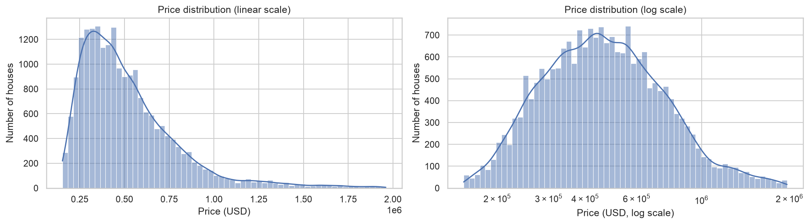
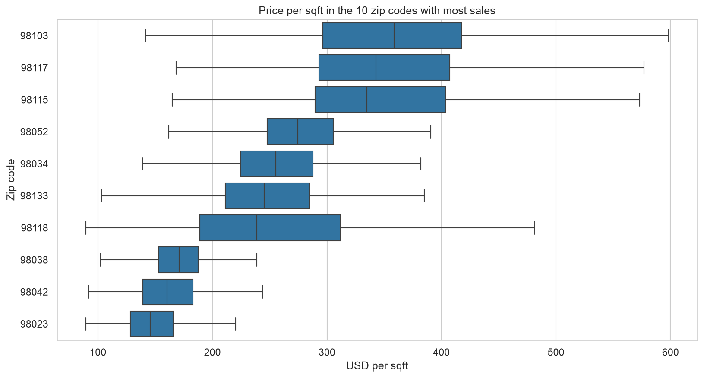
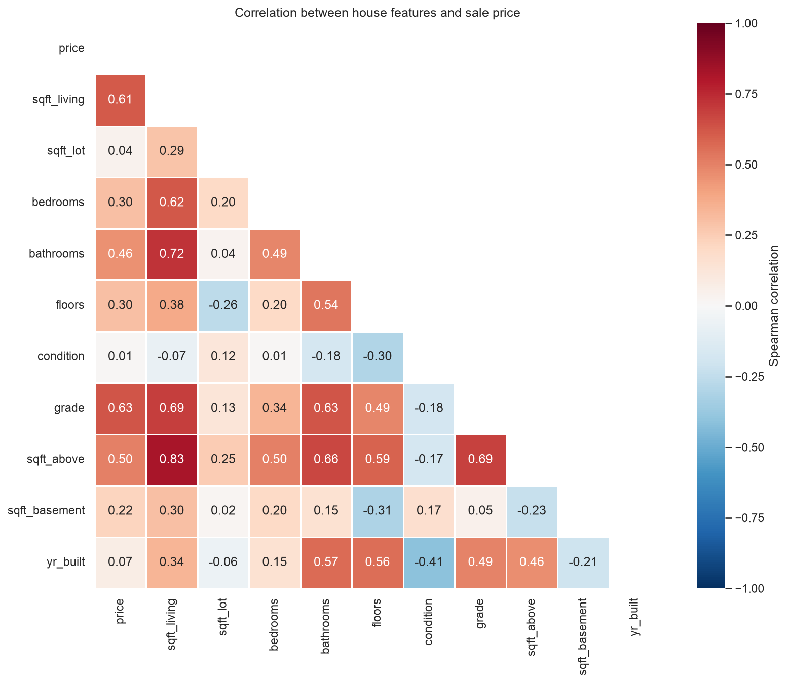

# Group 2 - House Sales: Data Cleaning and EDA

This project explores house sales in King County, Washington, USA. We clean the dataset and examine how price relates to house size, bedrooms, construction quality and location.

## Team members

- Karthikeyan Saravanan
- Emmanuel Marquez
- Bars babila
- Samiha Abeda Nur

## Use case

Which physical characteristics of a house (size, construction quality, age, basement, renovation) are associated with a higher sale price once location is taken into account? For architects and developers, this shows which design decisions the market values. The clean dataset will be used on Day 2 to predict the sale price.

## Repository structure

```
2-day1-assignment/
├── data/                  # Not tracked by git; the dataset is downloaded by the notebook
├── figures/               # Figures exported by the notebook (PNG)
├── notebook/
│   └── Day1Group2.ipynb   # Data cleaning and exploratory analysis
├── requirements.txt       # Python packages with fixed versions
├── LICENSE                # MIT licence for the code
└── README.md
```

## How to run

1. Install Python 3.12 and clone the repository:

   ```bash
   git clone https://github.com/iaac-maai/2-day1-assignment.git
   cd 2-day1-assignment
   ```

2. Create a virtual environment and install the dependencies:

   ```bash
   python -m venv .venv
   # Windows
   .venv\Scripts\activate
   # macOS / Linux
   source .venv/bin/activate

   pip install -r requirements.txt
   pip install jupyter
   ```

3. Open `notebook/Day1Group2.ipynb` and run all cells (*Restart kernel → Run All*).

**Data:** you don't need to download anything by hand. The notebook uses `kagglehub` to download `kc_house_data.csv` from the Kaggle dataset [harlfoxem/housesalesprediction](https://www.kaggle.com/datasets/harlfoxem/housesalesprediction) and caches it locally. CSV files are excluded from the repository by `.gitignore`.

## Dataset

We use the **House Sales in King County, USA** dataset from Kaggle, covering sales between May 2014 and May 2015.

- Original dataset: 21,613 rows and 21 columns
- After cleaning: 20,703 rows
- Main variables: price, bedrooms, bathrooms, living area, lot area, floors, condition, grade, construction year and ZIP code

Source: https://www.kaggle.com/datasets/harlfoxem/housesalesprediction

## Data cleaning

We checked the data for duplicate records, missing values and unusual values. 

Most of the dataset is already well-structured and ready for analysis, requiring only a few adjustments.

**Date formatting:** We convert the 'date' column from a string to a datetime format to make it easier to work with.

**Column removal:** We remove the 'view' and 'waterfront' columns because their values are heavily concentrated at zero, with relatively few observations having higher values. We decide to exclude these features to simplify the dataset and focus on variables with greater variation.

We filtered records using the 1st and 99th percentiles of price, living area and bedroom count. This removed 910 records. These thresholds help focus the analysis on typical sales, but may also exclude genuine unusual properties.

For the analysis, we added:

- Living area in square metres
- Price per square foot
- Price per square foot relative to the ZIP code median
- Indicators for basements and recorded renovations
- Construction-period groups

## Exploratory data analysis

The notebook includes:

- Descriptive statistics
- Distributions of prices, sizes and house characteristics
- Comparisons between ZIP codes
- Analysis of grade, basements, renovations, age and condition
- Summary tables using groupby and crosstab
- A Spearman correlation heatmap
- A pair plot of price, living area and bathrooms
- Bedroom and price comparisons across four ZIP codes

## Main findings

- Prices are right-skewed: median 450,000 USD vs mean 519,000 USD, so we use the median and will model log(price).
- Three- and four-bedroom houses account for most sales.
- Median price generally increases with bedroom count and living area.
- Grade and living area have the strongest correlations with price among the features included in our heatmap: 0.63 and 0.61.
- Location drives the price per sqft: among the 10 ZIP codes with most sales, the most expensive (98103, ≈360 USD/sqft) costs about 2.5× the cheapest (98023, ≈145 USD/sqft). Prices differ across ZIP codes even for houses with the same bedroom count.
- Compared with their own ZIP code, houses with a basement are ≈6% below the median price per sqft and houses without one ≈4% above. Renovated houses (4% of sales) are ≈4% above.
- Houses built before 1960 are slightly above their ZIP code median, newer ones around or just below it.
- Living area, above-ground area and bathrooms contain overlapping information.
- Condition has a weak overall correlation with total price, although patterns may differ within locations.



*The price distribution is right-skewed with a long tail of expensive houses, which is why we report the median and will model log(price).*



*Among the 10 ZIP codes with the most sales, the median price per sqft varies by about 2.5×, which shows that location is a major driver of price.*



*Grade (0.63) and living area (0.61) have the strongest correlations with price, and living area, above-ground area and bathrooms overlap strongly with each other.*

These findings show associations, not proof of cause and effect.


## Limitations

- The data covers one area in 2014–2015, so the findings may differ elsewhere or today.
- Removing unusual records affects the results.
- Some groups contain fewer sales, making comparisons less reliable.
- Several connected features can affect price at the same time.

## AI usage disclosure

- **Tools:** [e.g. ChatGPT (GPT-x), Claude, GitHub Copilot]
- **Why:** [e.g. to debug pandas errors, to look up seaborn syntax, to improve the wording of interpretations]
- **Where:** [e.g. the outlier-filtering code, the correlation heatmap cell, the README text]
- **How:** [e.g. we asked for explanations or code snippets, then read, tested and adapted them to our data; we checked every number in the findings against the notebook output]
- **Lessons learned:** [e.g. AI suggestions sometimes used column names that don't exist or deprecated functions, so we had to verify outputs; it was most useful for plotting syntax, less useful for deciding on interpretations]

## Licence

- **Code:** MIT licence, see [LICENSE](LICENSE).
- **Data:** the King County house sales dataset is published on Kaggle under **CC0: Public Domain** by harlfoxem ([source](https://www.kaggle.com/datasets/harlfoxem/housesalesprediction)). The data is not redistributed in this repository.

